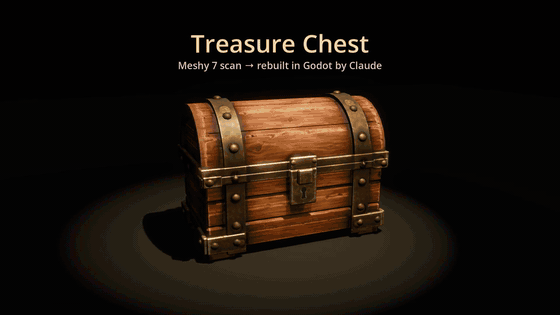
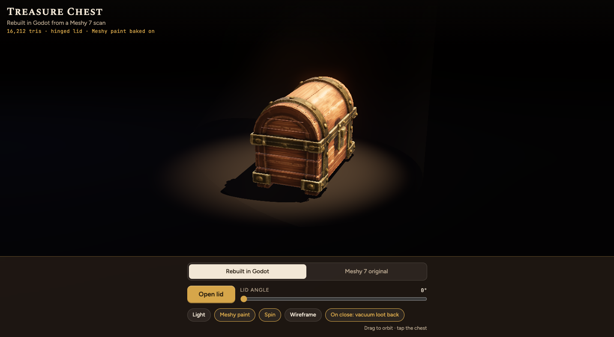
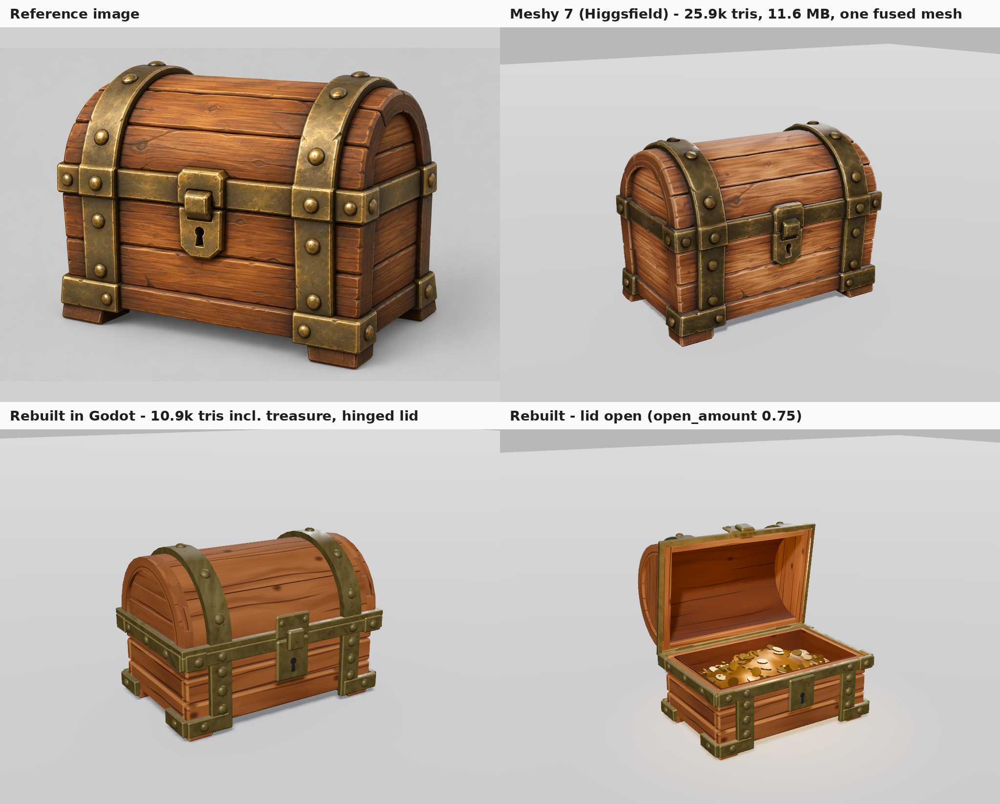

# image-to-3d-rebuild

A [Claude Code](https://claude.com/claude-code) skill (also works in Codex) that turns a picture of an object into a polished, animated 3D asset.



Full demo video (50 s):

https://github.com/user-attachments/assets/30369f14-36e3-4df7-9c90-64d45fc029b0

(Also in the repo: [media/treasure_chest_demo.mp4](media/treasure_chest_demo.mp4).)

<a href="https://undeadpickle.github.io/image-to-3d-rebuild/"></a>

**[Try the interactive 3D viewer](https://undeadpickle.github.io/image-to-3d-rebuild/)** (Cmd/Ctrl-click to open it in a new tab): tap the chest to open it, watch the loot physics, and switch between the rebuild and the original Meshy scan. It's the web viewer this skill produces (three.js, works on a phone). Source: [docs/](docs/).

An AI scan (Meshy, Tripo or similar) is used only as a reference. The deliverable is a clean rebuild in Godot, with the scan's paint baked on, animation and effects that follow Disney's 12 principles at 50% strength, a phone-friendly three.js web viewer, and a demo video.

The workflow comes from r/aigamedev's "new crazy workflow for making 3D assets". This skill adds the steps that make the result good: measure, bake, animate, add effects, test, ship.

## What you get

Same chest, four stages. Top left is the reference image, top right the raw AI scan, bottom row the clean Godot rebuild (closed and open).



| | Raw scan | Rebuild |
|---|---|---|
| Triangles | 25.9k | 10.9k in Godot including the treasure (16.2k in the web viewer's export) |
| Mesh | one fused piece | separate parts with a hinged lid |

Moving parts, clean edges and low poly are the point. The scan keeps its job as the measuring stick and the paint source.

## Pipeline

1. Start with an image of the object.
2. Generate a rough 3D scan (Meshy, Tripo, Rodin).
3. Import it into Godot and measure it.
4. Rebuild a clean version that matches the scan's proportions.
5. Bake the scan's painted textures onto the rebuild.
6. Animate and add effects.
7. Export a web viewer and a demo video.

`SKILL.md` has the full steps. `references/` has the detail for each one.

## Install

Clone this folder into your agent's skills directory.

Claude Code:

```sh
git clone https://github.com/undeadpickle/image-to-3d-rebuild ~/.claude/skills/image-to-3d-rebuild
```

Codex (same `SKILL.md` format, so the folder works as is):

```sh
git clone https://github.com/undeadpickle/image-to-3d-rebuild ~/.codex/skills/image-to-3d-rebuild
```

To use one copy for both, clone it once and symlink it into the other directory:

```sh
ln -s ~/.claude/skills/image-to-3d-rebuild ~/.codex/skills/image-to-3d-rebuild
```

## Use it

Give your agent an image and say what should move. For example:

> Make a 3D asset from this image of a treasure chest. It's about 60 cm wide, the lid opens, and I want coins and gems to spill out when you tap it.

The skill asks once, briefly, only if something is unclear: the object, its real size, which parts move, what interaction you want, and your generation budget. Tell it how hard to push the animation ("make it subtle, 30%" or "push it to 80%"). The default is 50%.

## Requirements

- Godot 4.x
- Python 3 with `numpy scipy xatlas pillow` (for the bake scripts)
- ffmpeg (for the demo video)
- A 3D generation service for the scan step. The examples use Higgsfield's Meshy tool (about 38 credits for one textured model at the time of writing), but any image-to-3D service that outputs a textured GLB works.

## Good to know

- **Built and tested on a treasure chest.** It should suit hard-surface props such as vehicles, buildings and robots. Organic characters are untested.
- **Paid generations are capped.** The skill preflights the price and submits exactly the number of generations you approved. It never resubmits after a timeout.
- **It doesn't touch your settings.** It never edits global settings or permissions to get around a prompt.
- **Check the visuals.** It compares renders side by side after every round instead of trusting the code.

## Heads up: `scripts/approver_mcp.py`

This optional script is Claude Code only (it targets `claude -p`). It auto-approves permission prompts so a headless `claude -p` run can submit a paid generation you already approved. It only approves a short allowlist and caps submissions, but it is still a permission bypass. Run it only on a prompt you wrote, and keep its tool lists short.

## License

MIT
